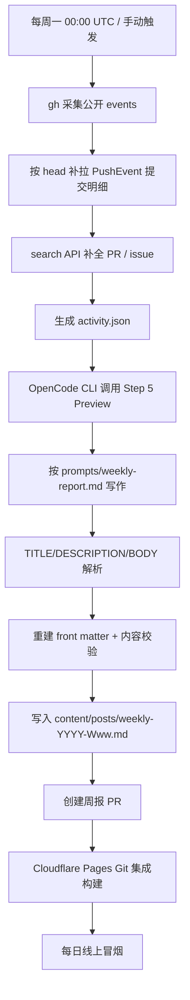

# 安卓人的技术周记

[](https://github.com/3y3y3y-huaiji/hugo-blog-loveit-theme/actions/workflows/ci.yml)
[](https://gohugo.io/)
[](https://github.com/dillonzq/LoveIt)
[](https://build.nvidia.com/stepfun-ai/step-5-preview)
[](https://pages.cloudflare.com/)
[](LICENSE)

> 一个个人技术周记：每周一 08:00（北京时间），GitHub Actions 用 `gh` 采集我过去一周的**公开 GitHub 活动**，交给 **OpenCode CLI + Step 5 Preview** 写成轻松随笔型周报，校验后创建 PR，人工合并后由 Cloudflare Pages Git 集成自动构建发布。

🌐 **在线站点**：[https://hugo-blog-loveit-theme.pages.dev/](https://hugo-blog-loveit-theme.pages.dev/)

## 环境基线

| 组件 | 实际值 / 使用方式 |
| --- | --- |
| 本机全局 Node.js | v26.13.1（`C:\Program Files\nodejs\node.exe`，PATH 中优先使用） |
| 本机全局 pnpm | 11.22.0（`C:\Users\安卓人\AppData\Local\pnpm\bin\pnpm`，PATH 中优先使用） |
| CI Node.js | 26.13.1（`.ci-node-version`；Pages 读取 `.node-version` 使用 Node 24） |
| CI Hugo | Extended 0.169.0（`.hugo-version`）；Pages 默认 0.147.7，模板兼容 0.140+ |
| OpenCode CLI | CI 使用 2.2.7；本机 Windows 上 native binary 不兼容，周报生成以 CI/WSL 为准 |
| npm registry | 本机为华为云镜像；`pnpm audit` 已内置 npmjs registry 覆盖 |
| 主要依赖 | Babel 8.1 / TypeScript 6.0.3 / ESLint 10.14 / Prettier 3.9 / typescript-eslint 8.72 / dotenv 18 |

可用 `pnpm run env:check` 复核本机环境。

## 核心功能

- **只记录自己的事**：采集 commits、PR、issue、release；不再抓 RSS 热点，不再批量生成通用 AI 资讯。
- **公开数据优先**：只读 `/users/{user}/events/public` 与 GitHub search API；不采集私有仓库、代码 diff、token 或邮箱。
- **OpenCode + Step 5 Preview**：通过 OpenCode CLI 的 `nvidia` provider 调用 `nvidia/stepfun-ai/step-5-preview`；模型只负责写作，采集、校验、发布由确定性脚本完成。
- **轻松随笔型风格**：语气、结构、输出格式都在 [`prompts/weekly-report.md`](prompts/weekly-report.md)。
- **明确的失败语义**：模型超时、输出不合约、正文太短都会让任务失败；本周没有公开活动时跳过，不编造内容。
- **完整质量门禁**：Prettier、ESLint、主题类型检查、内容契约、24 个 `node:test` 单测、Hugo 构建产物契约、生产依赖审计、Lychee 死链检查、线上冒烟。
- **历史归档**：早期 `ai-generated-*` 文章保留在 `content/archive/`，不再新增。

## 周报生成链路



## 项目结构

```text
hugo-blog-loveit-theme/
├── .agents/
│   └── AGENTS.md                 # Agent 硬约束、分支策略与质量门禁
├── .github/
│   └── workflows/
│       ├── ci.yml                # PR/Push 门禁：格式 / 内容 / 构建 / 审计 / 死链
│       ├── weekly-report.yml     # 每周一生成周报 → 校验 → 提交
│       └── smoke.yml             # 每日/手动线上巡检
├── config/
│   └── weekly-report.json        # 周报用户、模型、采集上限、排除仓库
├── prompts/
│   └── weekly-report.md          # 写作风格与输出契约
├── content/
│   ├── posts/                    # 周报与个人文章
│   └── archive/                  # 历史 AI 自动文章归档
├── scripts/
│   ├── collect-github-activity.ts
│   ├── generate-weekly-report.ts
│   ├── verify-content.ts
│   ├── verify-build.ts
│   ├── smoke.ts
│   ├── check-env.ts
│   ├── serve-public.ts
│   └── *.test.ts
├── e2e/                          # Playwright 浏览器端到端测试
├── playwright.config.ts
├── dist/                         # tsc 编译输出（gitignored）
├── tsconfig.scripts.json
├── themes/LoveIt/                # vendored 主题（含 TypeScript 源码）
├── docs/                         # 项目文档
├── hugo.toml
├── package.json
└── .node-version / .ci-node-version / .hugo-version
```

## Cloudflare Pages 设置

Pages 项目使用 Git 集成，不需要 `wrangler deploy`，也不需要 Cloudflare API Token。

| 设置 | 值 |
| --- | --- |
| Production branch | `main` |
| Build command | `hugo --gc --minify` |
| Output directory | `public` |
| Node version | `.node-version` 中的 `24`（无需设置 `NODE_VERSION`） |
| Hugo version | 默认 `0.147.7`；模板兼容 0.140+，可设 `HUGO_VERSION=0.169.0` 与 CI 对齐 |

主题 JS 已编译并提交在 `themes/LoveIt/assets/js/theme.js`，因此 Pages 构建只需要 Hugo；`pnpm run build` 用于本地或 CI 同时验证主题编译。自动化脚本是 TypeScript，由 `pnpm run build:scripts` 编译到 `dist/` 后运行，Pages 不依赖 `dist/`。

### GitHub Secrets

| Secret 名称 | 说明 |
| --- | --- |
| `NVIDIA_API_KEY` | 从 [NVIDIA Build](https://build.nvidia.com/) 获取的 `nvapi-` 开头密钥（第 1 把） |
| `NVIDIA_API_KEY_2` | 可选，第 2 把备用 key；前一把探测失败时自动切换 |
| `NVIDIA_API_KEY_3` | 可选，第 3 把备用 key |
| `GH_PAT` | 只读公开仓库的 PAT（classic `public_repo` 或 fine-grained 公开仓库只读）；用于跨仓库采集 |
| `WEEKLY_PR_TOKEN` | fine-grained PAT，仅本仓库 `Pull requests: Read and write` + `Contents: Read`；用于创建周报 PR |

> 多把 NVIDIA key 只会在同一个 `step-5-preview` 模型内轮换。如果是 NVIDIA 模型后端整体无响应，换 key 也无法恢复；工作流会逐把探测并给出每把 key 的 HTTP 状态。

> `WEEKLY_PR_TOKEN` 是独立 PAT，用来绕开仓库默认的 “GitHub Actions 不能创建 PR” 限制，避免全局打开 Actions 创建/批准 PR 的权限。

可选仓库变量 `SITE_ORIGIN` 用于部署后冒烟，默认 `https://hugo-blog-loveit-theme.pages.dev`。

> `GITHUB_TOKEN` 只能读当前仓库，无法分析你名下的其他公开仓库，所以跨仓库周报需要 `GH_PAT`。不要给 `GH_PAT` 私有仓库权限。

## CI 门禁

| Job | 内容 |
| --- | --- |
| `static` | Prettier → ESLint → 主题 + scripts TypeScript 类型检查 |
| `content` | 编译 scripts → 内容契约 → 25 个 `node:test` 单测 |
| `build` | 编译 scripts → Babel 编译主题 → Hugo 0.169.0 构建 → 产物契约 |
| `audit` | 只审计生产依赖的高危漏洞 |
| `link-check` | Lychee 死链检查（排除归档与外部站点） |
| `e2e` | Playwright Chromium 浏览器端到端检查（导航、搜索、主题、移动端、404） |

PR 与 push 都会跑；Cloudflare Pages 负责部署。`weekly-report.yml` 用 `GITHUB_TOKEN` push 不会触发 `push` workflow，所以 `ci.yml` 通过 `workflow_run` 接续检查。

## 本地开发

前置：全局 Node v26.13.1、全局 pnpm 11.22.0、Hugo Extended 0.169.0（本机未全局安装，需自行安装）、GitHub CLI、OpenCode CLI 2.2.7（本机 Windows 上不可用，建议 WSL/CI）。

```bash
pnpm install

# 只采集公开活动，验证数据结构
pnpm run collect:activity -- --now 2026-11-12T12:00:00+08:00

# 生成周报（需要 NVIDIA_API_KEY、GH_TOKEN；Windows 建议用 WSL 或直接跑 CI）
pnpm run report:weekly

# 本地门禁
pnpm run check       # 格式 + ESLint + 类型检查 + 单测 + 内容契约
pnpm run check:full  # check + Hugo 构建 + 产物契约（需 Hugo 0.169.0）

# 浏览器 E2E（首次安装 Chromium）
pnpm run e2e:install
pnpm run build
pnpm run e2e

# 本地预览
pnpm run build:theme
hugo server -D
```

本地 `.env`（已被 `.gitignore` 保护）：

```env
NVIDIA_API_KEY=nvapi-your-real-key
NVIDIA_API_KEY_2=nvapi-your-backup-key
GH_TOKEN=github_pat_public_read_only
```

## 分支与发布策略

- 人工与 Agent 改动走 Feature 分支 + PR，`main` 受保护。
- 唯一例外：`weekly-report.yml` 会在生成周报后创建 `weekly-report/YYYY-Www` 分支和 PR，并触发 CI；仍需人工合并，不直接 push `main`。
- 详细规范见 [`.agents/AGENTS.md`](.agents/AGENTS.md)。

## 许可证

本项目采用 [MIT 许可证](LICENSE)。

## 致谢

- [Hugo](https://gohugo.io/)
- [LoveIt Theme](https://github.com/dillonzq/LoveIt)
- [NVIDIA Build](https://build.nvidia.com/)
- [OpenCode](https://opencode.ai/)
- [Cloudflare Pages](https://pages.cloudflare.com/)
