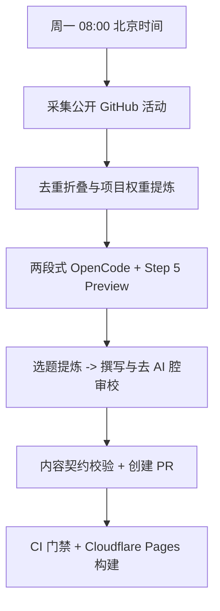

+++
title = "关于"
date = 2026-11-12T08:00:00+08:00
draft = false
author = "安卓人"
description = "安卓人的个人主页与技术周记说明：聚焦形式化验证（Lean 4 / Mathlib4）、几何深度学习与系统/编译器工程。"
summary = "关于安卓人与这个技术周记：研究方向、代表项目，以及周报背后的自动化流水线。"
keywords = ["安卓人", "Lean 4", "Mathlib4", "几何深度学习", "技术周记", "OpenCode"]
+++

我是**安卓人**，一个把时间花在形式化验证、模型架构实验和系统工程上的开发者。

## 关注方向

- **形式化验证与定理证明**：Lean 4、Mathlib4，关心如何把严谨的数学证明做得更容易上手、也更贴近工程工具链。
- **几何深度学习与模型架构**：不可定向流形注意力机制、规范等变性与 LLM 基础结构实验（`mobius-attention` / SG-Möbius-RoPE）。
- **编译器与系统工程**：TypeScript、Rust、Python、Go 与 Cloudflare Workers，偏爱静态类型约束、可验证的边界以及能稳定跑在浏览器或边缘节点上的工具。

## 目前在做的项目

- **[Lean Init IDE](https://github.com/3y3y3y-huaiji/lean-init-ide)**（[在线演示](https://lean-init-ide.pages.dev) · [镜像站](https://criticalthinking.de5.net/)）：跑在浏览器里的零配置 Lean 4.34.1 学习环境。通过 WebAssembly 与 Web Worker 在本地运行语言服务器与诊断（仅含 `Init` 核心库，内置 22 节交互课程），无需安装 `elan` 或后端服务。
- **Mathlib4 贡献**：持续向 [leanprover-community/mathlib4](https://github.com/leanprover-community/mathlib4) 提交形式化证明与清理 PR（如 [#44798](https://github.com/leanprover-community/mathlib4/pull/44798)、[#44634](https://github.com/leanprover-community/mathlib4/pull/44634)）。
- **[mobius-attention](https://github.com/3y3y3y-huaiji/mobius-attention)**：探索 Data-Dependent Semantic Gauge Möbius Attention（SG-Möbius-RoPE）在非定向流形与相消干涉方向上的理论与小规模实验验证。
- **编译器与类型检查实践**：参与 `Go-Hybrid`（带所有权与可发送性检查的 Go 超集）等项目的 soundness 修复与边界测试用例补全。

## 这个博客现在怎么写

这个站点曾经是一台自动抓 RSS 写早报的流水线，后来我把那 290 多篇自动资讯全部移进了「归档」。现在这里只做一件事：**每周记录我自己真正在写的项目、踩过的坑和做的技术取舍。**

周报依然借助自动化工作流生成，但流水线本身也重写了一轮：

1. **只看公开仓库**：只读公开 events、commit 与 PR/issue 摘要，不碰私有仓库与未公开代码。
2. **先提炼再写作**：脚本先折叠 rebase 重复提交、按项目权重排序，再让模型聚焦本周 1~2 条主线深挖因果，而不是按固定八股模板把流水账平均铺满。
3. **不编造、不硬凑**：没有实质活动就跳过，只用可溯源的公开链接。

## 找到我

- GitHub：[3y3y3y-huaiji](https://github.com/3y3y3y-huaiji)
- 博客仓库：[hugo-blog-loveit-theme](https://github.com/3y3y3y-huaiji/hugo-blog-loveit-theme)
- 邮箱：`sumingkai1@outlook.com`
