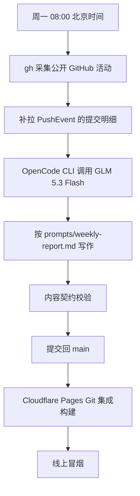

+++
title = "关于"
date = 2026-11-12T08:00:00+08:00
draft = false
author = "安卓人"
description = "关于这个个人技术周报：我每周在 GitHub 上做了什么，以及它是怎么被记录下来的。"
summary = "一个轻松随笔型的个人技术周报，记录公开 GitHub 活动、踩坑和下周打算。"
keywords = ["关于本站", "技术周报", "GitHub", "OpenCode", "GLM"]
tags = ["关于"]
+++

# 关于这个博客

这里是**安卓人的技术周记**，一个个人博客，不是科技新闻站。

我以前做过一段时间的“全自动 AI 热点博客”：每 4 小时抓 RSS、让模型挑一个热点写文章。它跑得很勤快，但写出来的东西更像资讯摘要，不像我自己的博客。所以现在换了个方向：**只记录我自己每周在 GitHub 上做了什么、踩了什么坑、下周打算干嘛。**

## 周报是怎么来的

每周一 08:00（北京时间），GitHub Actions 会跑一次周报任务：

几个我比较在意的点：

1. **只看公开仓库。** 采集的是 GitHub 的公开 events 和 search API，不碰私有仓库，也不抓代码 diff。周报里出现的链接都来自公开数据。
2. **事实和写作分开。** 采集脚本负责把 commits、PR、issue、release 整理成结构化摘要；GLM 5.3 Flash 只负责按我的语气写，不能编造活动。
3. **写作风格是单独的文件。** 语气、结构、输出格式都在 `prompts/weekly-report.md` 里。想改风格就改那一份，不用动代码。
4. **失败就失败。** 模型超时、输出不合约、正文太短，任务都会直接失败，不会硬凑一篇水文。
5. **本周没活动就跳过。** 没东西写的时候，承认没东西写，比让模型编一个“本周总结”更诚实。

## 为什么用 OpenCode + GLM 5.3 Flash

我想要的是“一个会读我活动数据的写作搭子”，不是“一个自动生成 SEO 文章的流水线”。

- OpenCode CLI 负责把模型、工具权限和输出收在一个可控的 agent 里；周报任务里它只被允许读 `activity.json` 和 `prompt.md`，不能执行命令、不能改仓库。
- NVIDIA NIM 上的 `z-ai/glm-5.3-flash` 支持长上下文和工具调用，用来读一周的活动摘要刚好。
- 模型只负责写，采集、校验、落盘、发布都由确定性脚本和 CI 完成。

## 历史文章

`content/archive/` 里还保留着早期 `ai-generated-*` 的自动热点文章。它们是我折腾自动化流水线时的产物，留着当归档，不再新增，也不会批量改写。

## 找到我

- GitHub：[3y3y3y-huaiji](https://github.com/3y3y3y-huaiji)
- 仓库：[hugo-blog-loveit-theme](https://github.com/3y3y3y-huaiji/hugo-blog-loveit-theme)
- 每篇周报底部都有 Giscus 评论区，欢迎来聊。
